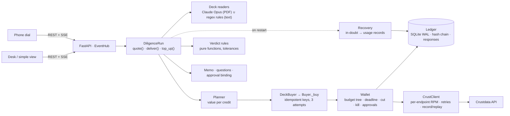

# Tally · Diligence Desk

**Every claim in a pitch deck is checked against outside records before the second meeting. Each verdict comes with a receipt, and the whole check stays inside a budget the partner sets.**

ContextCon 05, BITS Pilani · Theme 2, Investing · Statement 2.2, The Diligence Desk.

```
deck.pdf ─► read (Claude Opus + rules) ─► identify company ─► buy 1 record ─► QUOTE
        ─► partner accepts ─► ranked checks inside the ceiling ─► memo with receipts
        ─► questions for founders (held until the partner approves that exact set)
```

---

## Contents

1. [The problem](#the-problem)
2. [What the partner gets](#what-the-partner-gets)
3. [Why the memo can be trusted](#why-the-memo-can-be-trusted)
4. [Live results](#live-results-22-nov-2026)
5. [Run it](#run-it)
6. [Architecture](#architecture)
7. [The pipeline, step by step](#the-pipeline-step-by-step)
8. [The spending engine](#the-spending-engine)
9. [The verdict engine](#the-verdict-engine)
10. [Deck security](#deck-security)
11. [HTTP API](#http-api)
12. [Configuration and modes](#configuration-and-modes)
13. [Testing and evaluation](#testing-and-evaluation)
14. [Business case](#business-case)
15. [Design decisions](#design-decisions)
16. [Known limits](#known-limits)

---

## The problem

After a first meeting, a partner forwards the deck and the founders' names to the diligence team. An analyst then spends a day or two checking the deck against what's on record: the team size, the rounds, the investors, the founders' past jobs and the customers. The job is slow, it doesn't happen for every deck, and the output is usually a page of notes with no source for each line.

Automating it with "give an LLM the deck and some tools" fails on three counts:

| What goes wrong | Why it matters |
|---|---|
| Spend has no ceiling | A prompt can't enforce a budget. Paid data APIs bill per call. |
| The deck is adversarial | It was written by the company being checked, and it can carry instructions aimed at the AI reviewer. |
| "The model thinks it's wrong" isn't evidence | A partner can't take a hunch back to a founder. They need the field, the record and its date. |

Tally keeps the model for the one job it is good at, reading a messy PDF. Everything else runs in deterministic code: pricing, buying, judging and spending control.

## What the partner gets

**Before any money is spent beyond the first record**, a quote (the numbers here are illustrative):

> 14 claims in the deck. The company record already settles 9. For 30 credits, 13 of 14 get checked; a full check costs about 17.4 credits (₹1,400 at our price).

The quote includes a **coverage curve** (credits → claims checked), so the partner can see what each extra credit buys.

**After the run**, a memo containing:

- **One verdict per claim**, sorted by severity and then by materiality. Contradictions come first.
- **A receipt for each verdict**: the exact field or passage, the record or URL, the record's date, and the purchase (call key, request id, credits) that bought it.
- **Five comparable companies**, each with dated headcount, total funding and last round.
- **Questions for the founders**, generated from fixed templates and limited to 8. They are bound to a hash and written to an outbox only after approval.
- **An audit panel**: ledger hash chain OK, ledger credits vs. the account's balance drop, and model cost in ₹.

| Verdict | Meaning |
|---|---|
| **Confirmed** | A record says so, within the rounding tolerance. |
| **Contradicted** | A record that exists says otherwise. It is shown with its date. |
| **Records disagree** | Two records disagree with each other, e.g. a 20-day-old headcount vs. yesterday's job post. Both are shown with dates. |
| **Can't verify** | No record settles it. **A missing record is never a contradiction.** |
| **Held** | A source timed out three times, so the claim is held for a person. |
| **Not checked** | The budget or time ran out first. "Top up 20 credits" continues from there. |

**Controls while it runs**, from the desk or a phone on the same Wi-Fi: halve the budget, set a new limit, kill the run, approve or deny a large purchase. Each one takes effect before the next purchase.

## Why the memo can be trusted

| Guarantee | Mechanism | Where |
|---|---|---|
| A model never sets a verdict | Verdicts come from one pure function per claim kind, with fixed tolerances. The model's only output is a list of claims. | `diligence/claims.py`, `llm.py` |
| A model can't hide a claim | A regex reader runs on the text layer independently. Its claims are merged in whenever the model missed them. | `diligence/deck.py` |
| A misquote is caught | `quote_in_text` checks that each claim's quoted wording really appears in the deck's text layer. | `diligence/deck.py` |
| Spend can't exceed the ceiling | Each purchase is reserved at its **worst-case** price, under a lock, before the request leaves. | `wallet.py`, `prices.py` |
| Nothing is bought twice | The idempotency key is `sha256(run_id │ endpoint │ canonical_json(body) │ attempt)`. A settled key is served from the ledger for 0 credits. | `ledger.py`, `probes.py` |
| A crash never loses a charge | Write-ahead `reserved` entries and an `in_doubt` state, reconciled against Crustdata's usage records. | `recovery.py` |
| The ledger can't be edited quietly | Append-only, with each row hashed as `sha256(prev_hash + row)`. `tally verify` names the first tampered row. | `ledger.py` |
| Nothing goes to founders without a yes | Questions are bound to `sha256(run_id + exact questions)`. Approving writes them to `data/outbox/`. Nothing is sent automatically. | `diligence/memo.py` |
| Live data, labelled | `fake` and `replay` modes show a banner on every screen. | `api.py`, `static/*` |

## Live results (22 Nov 2026)

Two small decks about a real company (Razorpay), one accurate and one deliberately altered, run against live Crustdata:

| Deck | Claims | Verdicts | Credits | Model |
|---|---|---|---|---|
| Accurate | 10 | 10 confirmed. "3,000+ people" matched a record of 4,038. "Sequoia" matched Peak XV Partners (renamed). | 4.55, incl. 5 comparables | ₹2.22 |
| Altered | 8 | Contradicted, each with a dated source: team of 12,000 (record: 4,038), founded 2009 (2014), a Series H (rounds on record go to Series F), Accel and SoftBank as investors (not on record, and a web search found no page naming them investing). Tiger Global confirmed (Series A, 2015). "ex-Google" came back *can't verify*, because the founder's record lists only one past job. | 12.15 | ₹1.84 |

The first live run surfaced four problems. All four are fixed and covered in code:

1. `/company/identify` takes **one kind of identifier per call**, so Tally asks by domain, then by name.
2. Web search costs **2 credits** on this key, not the 1 in the docs. `PriceBook` now only ever *raises* a price from `/account/endpoints`, never lowers it.
3. Competitors come back as **domains with stray whitespace**, not ids. The schema layer normalises them.
4. Web evidence must **name both parties in the same sentence**. Otherwise an unrelated page can "confirm" an investor.

## Run it

Needs Python ≥ 3.12 and [uv](https://docs.astral.sh/uv/).

```bash
uv sync
cp .env.example .env          # CRUSTDATA_API_KEY, ANTHROPIC_API_KEY, TALLY_INR_PER_USD
uv run tally check            # first live calls (~2.2 credits): confirms response shapes. --full: ~5 more
uv run tally serve            # desk at http://localhost:8000, plain view at /simple, phone dial at /phone?run=<id>
```

Command line:

```bash
uv run tally diligence deck.pdf --founders "Asha Rao, Vik Mehta" --budget 150 --minutes 8 --out memo.md
uv run tally diligence deck.pdf --run-id <id>     # resume after a crash: nothing is bought twice
uv run tally diligence-eval sealed/answers.json   # run and score the sealed set
uv run tally verify                               # recompute the ledger's hash chain
uv run tally ledger <run-id>                      # print one run's ledger entries
uv run pytest                                     # 48 tests, all offline
```

**No keys?** Add `--mode fake` and use a deck from `tests/decks/`. These are made-up companies served by an in-process stand-in for Crustdata (`tally/crust/fake.py`). Without `ANTHROPIC_API_KEY`, the rules reader works alone.

`--out memo.md` also writes `memo.json` beside it, holding the full receipts.

## Architecture



**Layering.** Each layer knows only the one below it:

| Layer | Knows about | Doesn't know about |
|---|---|---|
| `CrustClient` | HTTP, headers, rate limits, retries, `X-Credits-Used` | budgets, claims |
| `Wallet` + `Ledger` | credits, reservations, deadlines, approvals | what's being bought or why |
| `Buyer` / `DeckBuyer` | request shapes, worst-case prices | verdicts |
| `schema.py` | Crustdata's JSON (the *only* place it is parsed) | everything else |
| `claims.py` | evidence dataclasses → verdicts | HTTP, money |
| `DiligenceRun` | orchestration | JSON shapes |

The spending engine (`session.py`, `wallet.py`, `ledger.py`, `recovery.py`, `probes.py`) has no diligence code in it. It was built first for a different problem statement and reused as-is when the project switched to 2.2 (see [`docs/PREPARED_BEFORE_START.md`](docs/PREPARED_BEFORE_START.md)).

### Source map

| File | Lines | Responsibility |
|---|---:|---|
| `tally/diligence/run.py` | 383 | `DiligenceRun`: the two-phase state machine (quote → deliver), comparables, check loop, re-judging, memo assembly |
| `tally/diligence/claims.py` | 643 | One judge per `ClaimKind`; tolerances; name, school and place normalisation; alias tables |
| `tally/diligence/deck.py` | 391 | PDF loading (pypdf), regex claim reader, instruction scanner, model/rules merge, quote verification |
| `tally/diligence/planner.py` | 123 | Materiality and settle-chance priors; `next_action` greedy by value per credit; quote plan |
| `tally/diligence/probes.py` | 184 | Identify, enrich, jobs, founder, web, comparables; lookalike-domain detection |
| `tally/diligence/memo.py` | 152 | Memo rendering, receipts, question templates, approval binding, outbox |
| `tally/diligence/evaluate.py` | 79 | Sealed-set scorer |
| `tally/diligence/evidence.py` | 122 | Typed evidence: `CompanyProfile`, `PersonRecord`, `JobPosts`, `WebFinding`, `Comparable` |
| `tally/wallet.py` | 271 | `BudgetNode` tree, `Wallet.buy`, purchase lane, cut/extend/kill, approval requests |
| `tally/ledger.py` | 346 | Append-only SQLite ledger, hash chain, state folding, saved responses |
| `tally/recovery.py` | 84 | Crash reconciliation and balance check |
| `tally/session.py` | 109 | Shared run lifecycle: resume, limits, approval threshold, key prices |
| `tally/probes.py` | 59 | `Buyer._buy`: the single place a purchase happens |
| `tally/prices.py` | 79 | Worst-case `PriceBook`, raised from `/account/endpoints` |
| `tally/crust/client.py` | 192 | Async httpx client, sliding-window rate limiter, retry policy, record/replay |
| `tally/crust/schema.py` | 256 | Crustdata JSON → evidence dataclasses |
| `tally/crust/fake.py` | 461 | Offline Crustdata stand-in for tests and `--mode fake` |
| `tally/llm.py` | 74 | The only model call |
| `tally/api.py`, `events.py` | 333 | FastAPI app, SSE event hub, web approver |
| `tally/static/*.html` | | Desk (`/`), plain view (`/simple`), phone dial (`/phone`) |

## The pipeline, step by step

A run has two phases, so a partner can see the price before committing to it.

### Phase 1: `quote()`

1. **Account for the past.** Load this key's prices and rate limits from `/account/endpoints` (free). A new run records the starting credit balance. A resumed run reconciles anything a crash left in doubt (see [Crash recovery](#crash-recovery)).
2. **Read the deck.** If the reading is already saved on the run, it is reused and nothing is paid twice. Otherwise:
   - **Model reader:** Claude Opus receives the PDF as a `document` block plus the text layer. It returns a `DeckReading` through structured output (`messages.parse`, `output_format=DeckReading`, effort `medium`, server-side fallbacks on). Tokens and ₹ cost go on the ledger.
   - **Rules reader:** regexes over the text layer for headcount, hiring, money (₹/$/crore/lakh/mn/bn), rounds, investors, founding year, founders' employers and schools, customers and the domain.
   - **Merge:** model claims ∪ rules claims the model missed (deduplicated by `claim_key`).
   - **Filter:** `checkable()` drops forward-looking statements ("we will…") and names that aren't names. Each dropped claim is logged.
   - **Scan:** `find_instructions()` flags reader-directed text. It is logged and otherwise ignored.
3. **Identify the company**, by domain and by name, at 0.2 credits each. `domain_check` compares the two results (see [Lookalike domains](#lookalike-domains)).
4. **Buy the company record.** One Company Enrich call (2 credits) returns headcount with history, funding rounds with investors and dates, founders and leaders with work history and schools, competitors, locations, revenue band and open roles. Most claims settle here.
5. **Judge every claim** against that record. Some verdicts are marked `provisional`: one more check could still change them.
6. **Carve the comparables sub-budget**: `min(8, 25% of budget, available)`. It is a child node in the budget tree, so comparables can't spend into claim checks.
7. **Quote.** The planner's ordered plan is walked cumulatively to build the coverage curve `[(credits, claims settled)]`. The quote reports claims settled at this budget, the full-check cost, and the cost and price in ₹.

### Phase 2: `deliver()`

8. **Comparables.** The company's own competitors on record come first, matched exactly by id or domain, and tiny SEO competitors (under a tenth of the company's size) are dropped. If fewer than 3 remain, companies in the same industry, country and size band, each with a funding record, fill the rest, up to 5.
9. **Check loop.** Repeat until nothing is worth buying:
   - `planner.next_action(claims, evidence, available)` picks the affordable check with the highest value per credit.
   - Buy it, then re-judge **every** claim. One job-post purchase can change both a headcount and a hiring verdict. Each changed verdict is pushed over SSE.
   - Handling by outcome: `killed`/`deadline` stop the loop. `denied` blocks that check for good. `over_budget` (after a cut) re-plans with what's left. A timeout after 3 attempts marks the claims *held*. `402` stops the run. `403`/`400` block that check.
10. **Memo.** Results are sorted by verdict severity, then materiality, then deck order. When several claims share a purchase, its cost is split evenly between them. Questions are generated and bound. Ledger credits are compared with the account's balance drop.

**Top-up** after the memo raises the root limit and extends the deadline, then calls `deliver()` again. The planner's `done` set and the ledger's saved responses mean only new checks are bought.

## The spending engine

### Budget tree

```
client (150)
├── comparables (8)            ← carved; can only be granted more by its parent
└── [claim checks spend from client.available()]
```

```python
available(node) = limit − spent − reserved − Σ child.limit
committed(node) = spent + reserved + Σ child.committed()
```

- `carve(id, amount)` creates a child out of the parent's `available()`. A child can't raise its own limit. Only `grant` from its parent can.
- `cut(new_limit)` resizes the tree top-down. Each child keeps at least what it has committed. The remaining room is shared out in proportion to each child's unused headroom. A limit below what's already committed is allowed: nothing new can be bought until it rises.
- A **kill** flag and a **deadline** (epoch seconds, persisted) are checked on every reservation.

### The purchase protocol (`Wallet.buy`)

```
saved_response(key)?  ──yes──► return it, log "cached", 0 credits
        │ no
est_max > approve_over? ──yes──► ApprovalRequest(binding = sha256(key|credits)) → wait for a person
        │
  ┌──── purchase lane (asyncio.Lock: one paid call in flight) ────┐
  │ check killed / deadline / est_max ≤ node.available()          │
  │ node.reserved += est_max; ledger.reserve(...)  ← committed    │
  │ perform HTTP                                                  │
  │   ok        → reserved −= est_max; spent += X-Credits-Used;   │
  │               ledger.settle(body, credits, request_id)        │
  │   HTTP err  → ledger.fail(credits from header, normally 0)    │
  │   timeout / → ledger.mark_in_doubt; counted at est_max until  │
  │   no reply    reconciled                                      │
  └───────────────────────────────────────────────────────────────┘
```

- **Worst-case pricing.** `PriceBook` holds an upper bound for every endpoint, including premium field groups, which are billed twice (once to filter, once to return). Prices loaded from the key's endpoint list can only raise these bounds.
- **Approval threshold.** A single purchase above `max(25% of budget, 20 credits)` needs a person's yes. Setting the budget approves everything below that. With no one watching, the default is `DenyAll`.
- **One lane.** Paid calls are serialised. When a cut, kill or deadline fires, at most the one call already in flight settles.
- **Retries.** `Buyer._buy` tries up to 3 times. Each attempt is a *new* call key, so an in-doubt attempt stays on the ledger for reconciliation and is never overwritten.

### The ledger

SQLite in WAL mode with `synchronous=FULL`, so a committed entry survives a hard kill. Three tables:

| Table | Holds |
|---|---|
| `runs` | id, limits, deadline, mode, status, JSON `details` (quote, deck reading, questions, binding, starting balance) |
| `entries` | append-only events: `reserved · settled · failed · in_doubt · resolved · cached`, for kinds `crustdata · model · payment · message` |
| `responses` | the response body per call key, written in the same transaction as `settled` |

A call's state is a **fold** over its entries, oldest first. Rule 3, "when unsure, count it", means an `in_doubt` call is charged at its reserved amount until it is resolved. The ledger may overcount for a moment but never misses a charge.

Every entry stores `prev_hash` and `row_hash = sha256(prev_hash + canonical_json(15 hashed columns))`. `verify_chain()` recomputes the whole chain and returns the first bad `seq`. Model calls and the partner's decision on the questions are entries in the same chain, so one audit covers data spend, model spend and the human decision.

### Crash recovery

On restart with the same `run_id`:

1. The original limits and deadline are reloaded from `runs`.
2. Every open `reserved` entry for the run becomes `in_doubt`.
3. `GET /account/usage/events` (free) since the run started is fetched. Charges whose `event_id` isn't already on the ledger are matched to in-doubt calls by endpoint and resolved at the real amount. An unmatched call resolves at 0.
4. The deck bytes (`data/decks/<run_id>`) and the saved `deck_reading` are reused, so the model isn't called again.
5. Every request is deterministic, so every purchase that already settled is a ledger hit at 0 credits.
6. At the end, `credits_charged(run)` is compared with `starting_balance − current balance`. They must match within 0.005 credits. This assumes no one else spends on the same key during the run.

### Crustdata client

- Sliding-window rate limiter **per endpoint**, with requests-per-minute loaded from `/account/endpoints` (defaults: enrich 15, search/identify 30, web 10; `/account/*` 60 shared).
- `429` is retried up to 5 times and `5xx` up to 2 times. Neither is charged. Waits are capped at 60 s.
- A timeout or network failure raises `SourceTimeout`, which is deliberately *not* a `CrustError`. With no response there's no way to know whether the call was charged, so the wallet keeps it in doubt.
- Errors map to typed exceptions, each telling the caller what to do: `BadKey` (401), `OutOfCredits` (402), `EndpointForbidden` (403), `BadRequest` (400), `RateLimited`.
- `record` mode saves each response. `replay` serves the saved ones for free and shows a REPLAY banner. Replay is insurance for the demo, not a data source.

## The verdict engine

`judge(claim, index, evidence) → Judgement(verdict, reason, sources, provisional)`. There is one function per `ClaimKind`, and each is pure: it takes the evidence bought so far and returns a verdict.

### Claim kinds, with planner priors

| Kind | Materiality | Settled by |
|---|---:|---|
| investor | 1.0 | company record (company + per-round investors); web search |
| headcount | 1.0 | company record; job posts (newer team size) |
| funding_total | 0.9 | company record; web |
| last_round | 0.8 | company record rounds; web |
| founder_past_employer · founder_role | 0.8 | company record people; founder's own record |
| revenue · customer | 0.6 | web only (customer needs a named subject) |
| founder_education · hiring · headcount_growth | 0.5 | record / founder record / job posts / headcount series |
| partner_or_award · founded | 0.4 | web / record |
| location | 0.3 | HQ, addresses, headcount-by-region |
| other_metric | 0.2 | web, only when the claim has a specific number |

### Tolerances

Decks round up more often than they lie, so each threshold is a named constant in `claims.py`:

| Claim | Confirmed | Contradicted | In between |
|---|---|---|---|
| Headcount (exact) | `0.6·rec ≤ n ≤ 1.25·rec + 5` | `n ≥ 1.5·rec` **and** `n − rec ≥ 10` | can't verify |
| Headcount ("60+") | `rec ≥ n/1.25 − 5` | as above | can't verify |
| Funding total | `\|n − rec\| ≤ 20%` | `n ≥ 1.6·rec` | can't verify; a deck claiming *less* is never contradicted (it may count one round) |
| Growth (12 mo) | within 35% of the claimed growth (+3 pts) | actual < half the claimed growth | can't verify |
| Founded | ±1 year | beyond | |
| Hiring | open posts ≥ 50% of the claimed hires | | |
| Past employer | listed | missing **and** the person's record lists ≥ 2 past jobs | can't verify (thin history proves nothing) |

### Rules that prevent false accusations

- **A missing record is never a contradiction.** Only a record that exists and says otherwise can contradict a claim.
- **Provisional contradictions get one more look.** A contradiction that a not-yet-bought check could overturn is marked `provisional`. The planner **doubles** the value of a web search that could overturn it, because calling a founder wrong deserves the extra credit.
- **Records disagreeing is its own verdict.** A headcount record from weeks ago vs. a newer job post that states a team size gives *records disagree*, with both dates shown. The deck isn't called wrong.
- **Web evidence must co-locate.** For funding claims, the investor's name, the company's name and a funding word (*invest, led, round, raise, backed, seed, series…*) must appear in the same sentence of a result. For a figure, the number must be stated there too.
- **Name matching** normalises Unicode, strips suffixes such as "Ventures", "Capital" and "Partners", and uses alias tables: Sequoia India ↔ Peak XV, Google ↔ Alphabet/DeepMind, Facebook ↔ Meta, Bangalore ↔ Bengaluru.
- **People are matched by company id, never by name alone.** Founders with common names don't collide.

### Planner

```
value(check) = Σ over claims it could change of
               materiality(kind) × P(settles | check) × (1 − settled(claim))
pick           argmax value / worst_case_cost,  subject to cost ≤ available,  value/cost ≥ 0.02
```

`settled(claim)` is 1.0 for confirmed or contradicted, 0.9 for records disagree, 0.6 for can't verify, 0.5 for held and 0 for not checked, halved when the verdict is provisional. The candidate checks are job posts (20 results), one founder's own record (enrich by profile URL, else a search scoped to the company), and one web search per claim that a search could settle. At a small budget this greedy order is the triage: investors and headcount get checked before logos, and the rest honestly say *not checked at this budget*.

## Deck security

### Prompt injection

The deck is treated as hostile input in three layers:

1. **The prompt** tells the model the deck is untrusted. Text addressed to reviewers gets copied into `reader_instructions`, never followed.
2. **A regex scanner** (`INSTRUCTION_PATTERNS`) runs on the text layer whatever the model does. It catches "ignore previous instructions", "AI reviewers … rate/score/approve", "do not verify", "mark all claims as confirmed", "system prompt" and similar.
3. **Architecture.** Even if both layers miss an injection, it has nothing to act on. The model has no tools, no budget access and no say over verdicts. Question text comes from fixed templates, so nothing the deck says can write a question.

Instructions that are found show up on the memo and in the run log. `tests/decks/ledgerline_injected.txt` covers this.

### Lookalike domains

The company is identified **both** by the deck's domain and by its name. `domain_check`:

- If the two resolve to **different companies**, the check runs against the company found by name, and the memo flags it.
- If the name resolves but the domain doesn't, `looks_alike()` tests for a homoglyph fold (`0→o`, `1→l`, `rn→m`, …), an edit distance ≤ 2 after removing hyphens, or the same label with a different TLD (`paysetu.co` vs `paysetu.in`).

Either case adds a question for the founder ("Which domain is yours?"). The test decks are `kredbloom_lookalike.txt` and `kredbloom_altered.txt`.

## HTTP API

`uv run tally serve` → FastAPI on `:8000`. All live progress arrives over Server-Sent Events.

| Method | Path | Purpose |
|---|---|---|
| `GET` | `/`, `/simple`, `/phone` | Desk, plain view, phone dial |
| `GET` | `/api/info` | Mode (for the banner) and the LAN URL for phones |
| `POST` | `/api/memos` | `{deck_b64, filename, founders[], domain?, budget=150, minutes=8}` → `{run_id}`. Starts phase 1. |
| `POST` | `/api/jobs/{id}/accept` | Accept the quote and start phase 2 |
| `GET` | `/api/memos/{id}` | The finished memo with receipts and audit (409 until done) |
| `POST` | `/api/memos/{id}/questions` | `{binding, approve}`. 409 if the binding doesn't match the waiting set. |
| `POST` | `/api/jobs/{id}/cut` | `{limit}` or `{factor}` (e.g. 0.5 halves what's *left*) |
| `POST` | `/api/jobs/{id}/topup` | `{credits}` after the memo; continues the checks |
| `POST` | `/api/jobs/{id}/kill` | No new purchases |
| `POST` | `/api/jobs/{id}/approvals/{binding}` | Answer a large-purchase approval |
| `POST` | `/api/jobs/{id}/resume` | Continue a run after the server was killed |
| `GET` | `/api/jobs/{id}/state` | Limit, spent, seconds left, killed, budget tree |
| `GET` | `/api/jobs/{id}/audit` | Chain check, ledger vs. balance, quote, last 200 entries |
| `GET` | `/api/events?run_id=` | SSE: `deck · quote · claim · reserved · settled · failed · cut · kill · approval_needed · flag · note · done · questions · error` |

The event hub keeps the last 500 events, so a page opened mid-run catches up.

## Configuration and modes

`.env` (see `.env.example`):

| Variable | Default | Meaning |
|---|---|---|
| `CRUSTDATA_API_KEY` | | Required for `live` and `record` |
| `ANTHROPIC_API_KEY` | | Optional. Without it, the rules reader works alone. |
| `TALLY_INR_PER_USD` | | Needed for ₹ quotes and to compare INR amounts in decks |
| `TALLY_MODE` | `live` | `live · record · replay · fake` |
| `TALLY_DATA_DIR` | `data` | Ledger, saved responses, decks, outbox |
| `TALLY_USD_PER_CREDIT` | `0.30` | The event values 15,000 credits at $4,500 |

Constants in code: `PRICE_MULTIPLE = 3.0` and the model `claude-opus-5-5` (`config.py`), `APPROVAL_SHARE = 0.25` and `MIN_APPROVAL_CREDITS = 20` (`session.py`), `COMPARABLES_SHARE = 0.25` and `COMPARABLES_MAX = 8` (`diligence/run.py`), `MAX_ATTEMPTS = 3` (`probes.py`), `MAX_QUESTIONS = 8` (`diligence/memo.py`).

| Mode | Crustdata | Banner | Use |
|---|---|---|---|
| `live` | real API | none | real memos |
| `record` | real API, every response saved | none | live runs you may want to replay |
| `replay` | saved responses, 0 credits | **REPLAY** | demo insurance |
| `fake` | in-process stand-in, made-up companies | **FAKE** | tests, trying it without keys |

On-disk layout under `data/`: `ledger.sqlite` (+WAL), `responses/` (record/replay), `decks/<run_id>`, `outbox/<run_id>.md`.

## Testing and evaluation

```bash
uv run pytest      # 48 tests, offline, ~30 s
```

| Suite | Covers |
|---|---|
| `test_wallet.py` | buy-once, over-limit refusal, a cut stops spending within one call, deadline, kill, large purchase waits for a person, timeout stays in doubt and counts, error responses are free; a Hypothesis property test that no budget-tree node ever overspends |
| `test_ledger.py` | settle and save, idempotent keys (and fresh keys for retries), unfinished calls counted at reserved amount, model calls on the ledger, hash chain catches an edited entry |
| `test_recovery.py` | a crash after Crustdata charged is recovered exactly (per endpoint); a restart after a finished memo buys nothing |
| `test_client.py` | cost and request id on every call, 429/500 retried and not charged, 403 and timeouts raised, record → replay for free, live mode needs a key |
| `test_diligence.py` | rules reader, instruction detection, headcount tolerances (parametrised), missing record ≠ contradiction, name/school matching, altered and accurate decks end to end, injection inert, lookalike flagged, records disagree, small budget + top-up, crash mid-memo, question approval binding, sealed-set scorer, forward-looking claims dropped, web figures, growth, locations |
| `test_api.py` | the HTTP flow end to end: memo → accept → questions |

Test decks (`tests/decks/`, all fictional): `ledgerline_accurate`, `ledgerline_injected`, `kredbloom_altered`, `kredbloom_lookalike`, `tinyledger_disagree`.

**Sealed set.** A teammate, not the builder, wrote a set of decks with an answer file. Only `sealed.sha256` is committed. `tally diligence-eval sealed/answers.json` runs each deck and scores the result against the 2.2 criteria: every altered claim comes back contradicted with a source, no other claim is contradicted, lookalike domains are flagged, and hidden instructions are flagged without changing any verdict.

## Business case

| | |
|---|---|
| **Buyer** | Diligence teams at VC funds and advisory firms. Today an analyst spends 1–2 days per deck. |
| **Unit of sale** | One memo per deck, delivered before the second meeting |
| **Cost to serve** | ~5–15 Crustdata credits (~$1.50–$4.50 at $0.30/credit) + ~₹2 of model tokens |
| **Price** | 3× cost (`PRICE_MULTIPLE`): ~₹400–1,200 per memo, shown on the quote before any spend |
| **Margin control** | The budget is a hard ceiling. The quote's coverage curve lets the buyer pick their own price/coverage point. |
| **Why it scales** | One record settles most claims, so the marginal cost goes to the few claims that matter. Resume and replay mean no work is paid for twice. |

## Design decisions

| Option | Verdict |
|---|---|
| An agentic LLM with tools writes the memo | **Rejected.** It has no enforceable ceiling, the deck can steer it, and its verdicts have no sources. |
| Enrich everything about the company and every founder | **Rejected.** It pays for records no claim needs, and it still can't tell a thin record from a contradiction. |
| **The model reads, code prices, buys and judges** | **Chosen.** The ceiling and every verdict live in code. The cheapest record that settles the most claims comes first. A contradiction that one search could overturn gets that search before the memo calls a founder wrong. |
| Greedy value-per-credit planner vs. an optimal knapsack | Greedy. Fewer than 20 checks, and verdicts change after each purchase, so re-planning greedily after every buy beats a single up-front optimum. |
| SQLite vs. Postgres for the ledger | SQLite with WAL and `synchronous=FULL`. One process, durable on hard kill, no infrastructure, and the hash chain is portable as a single file. |
| Learning planner priors per deck | Not done. One deck is too little data, so `learn()` is a stub and the priors are fixed. |

## Known limits

- **Young companies with thin records** mostly come back *can't verify*, never *contradicted*. The founder questions ask for evidence instead.
- **The balance check** assumes no one else spends on the same API key during the run.
- **Revenue, customers and awards** can only be checked on the web. A customer claim needs a named subject to be worth a search.
- **INR amounts** can't be compared until `TALLY_INR_PER_USD` is set. They come back *can't verify* with that reason.
- **Comparables** need a funding record. Companies without one are skipped instead of padding the list.
- **Single process.** The purchase lane is an in-process lock. Running several workers would need the reservation step to move into the database.
