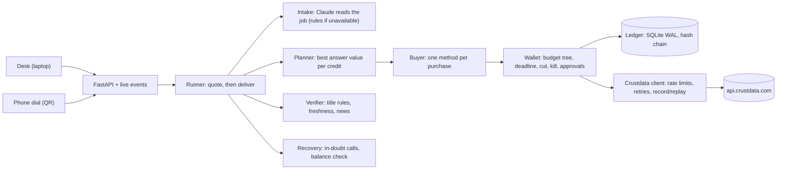

# Tally

**A research analyst that quotes, delivers and itemises, and can't overspend.**

ContextCon 05, BITS Pilani · Theme 7, Agents that spend · Statement 7.1, The Research Buyer

## The service

Research operations teams buy the data a client's job needs, inside the client's budget. In the handbook's words, that is who is paid for this today. A typical job: *"the head of engineering at 60 Indian fintech companies with 50–500 people, for 400 credits"*.

Tally does that job the way a good research firm does:

1. **Quote.** It does the job properly for 5 pilot companies, then forecasts the rest by resampling what those really cost. The client sees, before most of the money is spent:
   - credits needed (typical and high end)
   - expected answers at their budget
   - a coverage curve ("what more budget buys")
   - time, our cost in rupees and the price
2. **Deliver.** It buys one purchase at a time, always the one with the most expected answer value per credit. A batched person search covers 20 companies at once; the planner asks the company record only when the search found nobody, and checks the news only when a record is old. It learns as it goes which steps pay off. The client (or a judge, on their phone) can halve the budget or stop everything at any second.
3. **Itemise.** Every answer has a receipt:
   - the calls that bought it, with their request ids and this row's share of the cost
   - the exact field or passage behind each claim, and the record's date

   Pull the plug mid-run, restart, and the ledger still equals the drop in the Crustdata balance, to the credit.

After the run:
- **Top up.** "Top up 50 credits" continues where the budget ran out, and nothing already bought is bought again.
- **The bluffing seller.** A simulated data vendor (our own service, labelled as simulated) pitches a "fresh" list. Tally checks a sample against its own receipts at no cost, then recommends buying, counters at the price times the measured accuracy, or declines, with evidence for every record.
- **Tally Wallet.** The same wallet as an MCP server, so any agent (Claude Code included) can call Crustdata under a cap it can't get around. Every call is priced at its worst case first and recorded in the same ledger.

What comes back for each company is never a guess. The statuses are:

| Status | Meaning |
|---|---|
| Confirmed | a strong title on a fresh record, or newer news agreeing |
| Probable | the record says so, but it is old or the title is borderline |
| Conflict | the record says one thing and newer news another: both shown with dates |
| Can't verify | no record settles it, and the row names what was checked |
| Held | a source timed out three times; held for a person, not read as "not found" |
| Not reached | the budget or time limit ran out first |

## The handbook's five rules

| Rule | Where Tally meets it |
|---|---|
| 1. Decisions on live data | Every answer comes from live Crustdata calls. `fake` mode (made-up data) is for tests only and shows a banner; `replay` mode is demo insurance and shows a REPLAY banner. |
| 2. A source for every claim | `Source` records the field or passage, the profile or page URL and the record's date (`tally/models.py`). "Can't verify" names what was checked. |
| 3. A person approves anything you can't take back | Setting the budget approves data purchases inside it. One purchase above a quarter of the budget waits for Approve on the desk or the phone, bound to `sha256(call + amount)` (`tally/wallet.py`). Tally sends no messages and makes no payments. |
| 4. A ceiling on every run | A credit limit and a time limit, enforced in code before every purchase. The ledger records every Crustdata call and every model call with its tokens and rupee cost (`tally/ledger.py`). |
| 5. Through a crash or a timeout | Each purchase is written `reserved` before the request and `settled` after. On restart, open calls become `in_doubt` and are resolved from Crustdata's usage records (`tally/recovery.py`). Re-running the same run id gets every past purchase back from the ledger for free. |

## Run it

```powershell
uv sync
copy .env.example .env      # fill in CRUSTDATA_API_KEY, ANTHROPIC_API_KEY and TALLY_INR_PER_USD
uv run tally check          # first live call: about 0.25 credits, checks the response shapes
uv run tally serve          # the desk at http://localhost:8000, the phone dial by QR code
```

From the command line:

```powershell
uv run tally run "Find the head of engineering at 60 Indian fintech companies with 50-500 people" --budget 400 --out report.md
uv run tally run "..." --budget 400 --run-id <id>    # resume after a crash: nothing is bought twice
uv run tally verify                                  # recompute the ledger's hash chain
uv run tally ledger <run id>                         # every entry of a run
uv run pytest                                        # all tests, offline
```

Give any MCP client a capped Crustdata wallet:

```powershell
claude mcp add tally-wallet -- uv --directory C:\path\to\this\repo run tally wallet --cap 20
```

To try everything without a key, add `--mode fake`. It uses made-up companies, and its results are not real.

## How it's built



| File | What it does |
|---|---|
| `tally/wallet.py` | Every paid call goes through here. Budget tree, one purchase in flight at a time, cut, deadline, kill, approvals. |
| `tally/ledger.py` | Append-only and hash-chained: reserve before buying, settle after, never edit. |
| `tally/crust/client.py` | Headers, per-endpoint rate limits, safe retries, `X-Credits-Used` and `X-Request-Id`, record and replay. |
| `tally/crust/schema.py` | The one place Crustdata's JSON is read; reduces people to the fields the job needs. |
| `tally/probes.py` | The purchases: list companies, identify, batched person search, company leaders, news, re-read a person. |
| `tally/planner.py` | Chooses the next purchase, and learns which steps pay off. `EnrichEverything` is the naive baseline. |
| `tally/verifier.py` | Fixed rules for titles, freshness and news. A model is only asked about borderline titles. |
| `tally/quoter.py` | The pilot-based forecast and the coverage curve. |
| `tally/recovery.py` | After a crash: reopen, reconcile against usage records, compare with the balance. |
| `tally/runner.py` | One job, start to finish. |
| `tally/vendor.py` | The simulated vendor and the free sample audit. |
| `tally/wallet_mcp.py` | Tally Wallet: the capped wallet as an MCP server. |
| `tally/check.py` | `tally check`: the first live call, to confirm the response shapes. |
| `tally/api.py`, `tally/static/` | The desk and the phone dial. |

**Models.** `claude-opus-5-5` reads the job into a structured `JobSpec`. `claude-haiku-5-5` gives a second opinion on borderline titles, in one batch. Neither touches money, and if either is unavailable, the rules decide.

## Sources and checks

| Source | Used for | Cost |
|---|---|---|
| Company Search (`/company/search`) | listing companies by country, industry and headcount | 0.03 a result + premium filters |
| Company Identify (`/company/identify`) | resolving a client's own list; aliases merge into one record | 0.2 per match |
| Person Search (`/person/search`) | engineering leaders at up to 20 companies per query | about 0.23 a result |
| Company Enrich (`/company/enrich`, people) | the leadership list when the search found nobody | 2 |
| Web Search (`/web/search/live`) | news that someone joined or left, for old records | 1 |
| Person Enrich (`/person/enrich`, no contact fields) | re-reading one person's record | 1 |
| Usage records, balance, endpoint list (`/account/...`) | reconciliation and the balance check | free |

**Where a person approves:** accepting the quote (the budget), and any single purchase over a quarter of it.

**The ledger:** every call, with its cost and request id. See `uv run tally ledger <run id>` or the audit screen.

## Business case

- **Who buys it:** research operations teams and agencies that build sourced lists for sales, recruiting and investing clients.
- **Cost to run one job:** credits × about $0.30 (the event site values 15,000 credits at $4,500) + model tokens at list price. The quote shows both in rupees.
- **Price:** the quote prices a job at 3× our cost (`PRICE_MULTIPLE` in `tally/quoter.py`).
- *Live numbers from today's runs go here.*

## Approaches considered

| Approach | Verdict |
|---|---|
| Enrich everything, then filter | Simple, but buys records that weren't needed and never notices someone who left. It is the baseline in the race. |
| Let the model call tools with "stay under budget" in the prompt | Rejected: a prompt can't guarantee a ceiling, and a retry after a crash can pay twice. |
| **Code-planned buying by value per credit, with a model only for judgement** | **Chosen.** The ceiling is enforced in code, the cheapest useful call comes first, and a call that only checks something is bought only when the record is old. |

## Who it could get wrong, and the guard

- **People with common names:** candidates are matched by company id, never by name.
- **Someone who left recently:** old records get a news check, and a contradiction becomes a conflict, not an answer.
- **Inflated titles at tiny firms:** title rules depend on company size, and borderline titles are never "confirmed".

## Scale

- **100 times the volume:** the per-endpoint rate limits are the bottleneck. One person search covers 20 companies, the ledger never buys the same thing twice, and the planner skips steps that rarely pay off. Past that, several keys can run under one budget tree.
- **A second client:** each client is its own budget root with its own run ids and receipts, so one can't spend another's credits. SQLite becomes Postgres.

## Tests

`uv run pytest` runs offline against `tally/crust/fake.py`, a made-up world with the edge cases built in:
- one company under two domains
- a lookalike company in another industry
- a company with no engineering leader on record
- a head of engineering who left after the record was updated
- a small company whose CTO is the answer
- two people with the same name

The tests cover:
- budget-tree properties (hypothesis)
- a cut stopping within one call
- the deadline, kill and approvals
- retries, 403s and timeouts
- the hash chain catching an edited entry
- a crash after Crustdata charged, on three endpoints, recovered exactly
- a cut surviving a restart
- the race against the naive buyer
- the top-up
- the vendor audit
- the Wallet's cap
- the web flow

## What was written before 10:15

See [docs/PREPARED_BEFORE_START.md](docs/PREPARED_BEFORE_START.md). The design is in [docs/system-design.md](docs/system-design.md).
# Tally

