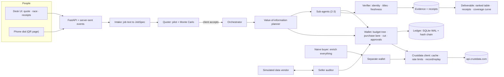
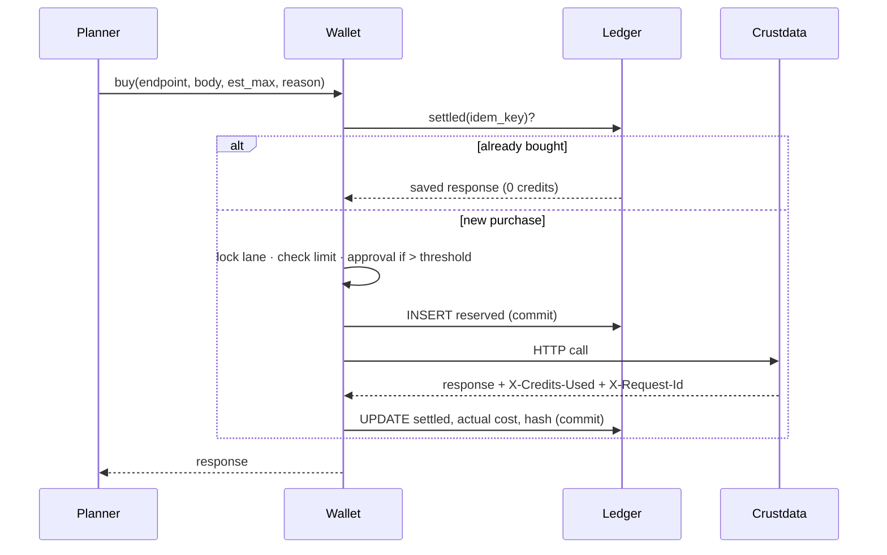
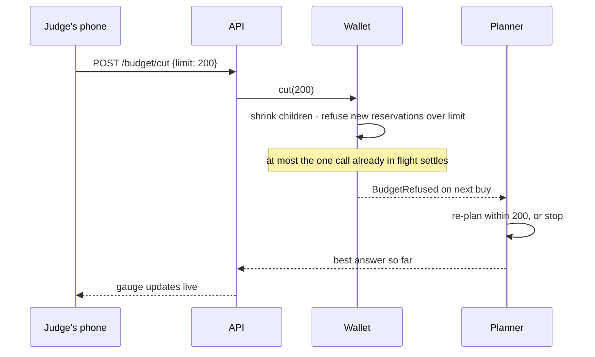

# Tally: system design for 7.1 The Research Buyer

ContextCon 05, BITS Pilani, 22 November 2026. "Tally" is a placeholder name.

Numbers marked *illustrative* are targets to measure on the day, not results. Crustdata facts come from the docs and the Builder Handbook as updated on 21 Nov (39 pages); check prices and limits with the free `GET /account/endpoints` call before relying on them.

**Updated 22 Nov for the revised handbook:**
- building starts at **10:15 AM**, so the build is 7 h 45 min
- Company Identify costs **0.2 credits per match** again
- the ledger must include **model calls**
- every run needs a **time limit** as well as a credit limit
- the judges want a **business case in rupees** and a **scale answer**

The changes are marked in the sections below, and §1.1 maps the handbook's five rules.

---

## 1. The idea

Research firms work in a fixed order: they **quote** a price before starting, **deliver** within it, and **invoice** line by line. Tally does that job as software.

1. **Quote.** Before spending real money, it runs a tiny pilot and tells the client what their budget will buy, how long it will take and what it costs in rupees: "For 400 credits, expect about 50 of 60 answered, using about 110 credits, in under 20 minutes. Price ₹X; our cost to run ₹Y." *(illustrative)*
2. **Deliver.** It buys only the data that settles each question, choosing the cheapest call that is likely to work. The client holds the budget dial, literally on their phone, and can cut it at any second.
3. **Invoice.** Every answer comes with a **receipt**: what it cost, which call bought it, the source passage, and the record's date. Pull the plug mid-run and nothing is ever bought or counted twice. The ledger matches Crustdata's own billing to the credit.

**One-line pitch:** *A research analyst that quotes, delivers and itemises, and can't overspend.*

This framing turns 7.1 from "infrastructure" into a **service a customer would buy**, which is what the judges score. The budget governor and ledger are the reasons the customer can leave it running unattended.

The handbook's theme page now says who pays for this today: *"Research operations teams, for buying the data a client's job needs, inside its budget."* Use that line in the README and the video.

### 1.1 The handbook's five rules, and where Tally meets each

The 21 Nov handbook lists five things every service must do, whatever its theme.

| Handbook rule | Where Tally meets it |
|---|---|
| **1. Decisions on live data.** Keep mock data for tests | Every answer comes from live Crustdata calls (search, enrich, web). Replay mode is only demo insurance, shown with a REPLAY banner, and the video says so |
| **2. A source for every claim.** It links to the exact passage or field and gives the record's date. Where nothing settles it, say "I can't verify" and name what's missing | Receipts (W5): the field or passage, the record's `updated_at` and the request ID. A "can't verify" row names the missing piece, for example "no record lists a current engineering head; the last one left in Aug 2026" |
| **3. A person approves anything you can't take back.** Payments run in Razorpay or Stripe test mode | Accepting the quote approves spending up to the budget. A purchase over the threshold, a vendor purchase (W6) and a top-up (W7) each wait for a person. Vendor and top-up payments run in **Stripe or Razorpay test mode** |
| **4. A ceiling on every run.** A time limit and a credit limit. The ledger records each call, **model calls included** | The wallet enforces both a credit limit and a deadline. The ledger has a row for every Crustdata call, Claude call and vendor payment |
| **5. Through a crash or a timeout.** It continues where it stopped, exactly once. A timeout means retry or hold for a person, never silence read as an answer | W4: reserve, then settle, with idempotency keys and reconciliation. After retries a timed-out source marks the company "held: source timed out", never "not found" |

---

## 2. The wow moments

| # | Moment | What the audience sees | Why it lands |
|---|---|---|---|
| W1 | **It quotes before it works** | A quote card with expected answers, credits (typical and high-end), time, and price and cost in rupees, plus a curve of "coverage you get for each budget" | Nobody else's agent prices its own work. It's exactly how a services firm behaves |
| W2 | **The judge holds the dial** | A QR code on screen; the judge's phone shows live spend and a "cut budget" button | The judges literally become the customer. The cut is real, and spending stops within one call |
| W3 | **The race** | Tally against a naive buyer that enriches everything, side by side on the same job, with right answers and credits ticking live | A visible, measured win: cost per right answer, Tally against the baseline |
| W4 | **Pull the plug** | Kill the process mid-run, restart, and a green check: "Ledger 87.43 = Crustdata 87.43" *(illustrative)*. A tamper check shows nobody edited the ledger | Audit-grade trust, shown live rather than claimed |
| W5 | **Receipts on every fact** | Click any name: the call that bought it, its cost, request ID, source passage, record date | Goes one step beyond the cited facts that won before: each fact has a source **and a price** |
| W6 | **The bluffing seller** | A simulated data vendor (an AI persona) pitches a "fresh" premium list. Tally audits a 5-record sample, finds 3 stale people with evidence, and declines or counters at a lower price | Agent against agent, with an evidence-based refusal |
| W7 | **What more budget buys** | After the run, a slider shows the coverage curve, and a "Top up 50 credits" button resumes exactly where it stopped | Lets the customer decide spending with data |
| W8 | **Tally Wallet** (stretch) | The same governor as an MCP server. Claude Code calls Crustdata through it under a 20-credit cap and is refused gracefully at the cap | Turns the idea into infrastructure Crustdata itself could sell: budget caps per API key |

**The 2-minute video uses W1, W3, W2 (the cut), W4 and W5.** Keep W6, W7 and W8 for the live finals, the README and the Q&A.

---

## 3. What the past winners did, and where Tally uses it

| Winner (place) | What stood out | How Tally uses it |
|---|---|---|
| **Agaxes** (IIT Bombay, 1st) | A control room for a company's AI agents | The run screen is a spend control room: budget tree, live spend, cut, kill. W8 extends it to any agent |
| **Markit** (IIT Bombay, 2nd) | Every claim cites a field in the Crustdata record. Recorded responses replay at no cost so the demo is dependable. Real email only to an allowlist. Deliberately small scope | Receipts on every fact (W5). A clearly labelled record/replay mode as demo insurance. Strict tiers so the core ships first |
| **Sightline** (IIT Bombay, 3rd) | Clickable evidence chips on every fact. Identity matching that **stops instead of guessing**. Sanity checks on implausible data. Charts | Identity resolution first (one company, one record). "Can't verify" instead of a guess. Sanity checks on titles and dates. Charts for the race and coverage curve |
| **FINN** (IIT Kanpur, 1st) | A ranked daily briefing with cited numbers | The deliverable is ranked: confirmed first, then probable, then can't verify, each row with its numbers and source |
| **AfterDegree** (IIT Kanpur, 2nd) | A clear outcome for a clear user. Drill-down from a summary to one individual record. A 2-minute demo video in the repo | Drill-down from summary to row to receipt to the raw Crustdata record. The video goes in the repo too |
| **Outcome AI** (IIT Kanpur, 3rd) | Authority configured once; people handle only exceptions. A decision ledger. Real actions on consenting test accounts. A full spec written before coding | Accepting the quote is the one setup decision. After that, approvals only for purchases over a threshold. The seller is your own simulated service (agents stay "in the room"). This design doc goes in `docs/` and is declared on the form |
| **SignalGate** (same team as Sightline; didn't place) | "Fixed rules make the decision; the AI never does." Falls back to rules if the model fails | All money decisions are code. If the AI model is down, title matching falls back to rules and the run still finishes |

**The idea that isn't obvious** (20 points for Customer value): research purchasing as a *value-of-information* problem. Each purchase is chosen by expected right answers gained per credit, and the planner learns which kinds of call actually settle questions as it goes. Plus a quote up front and an itemised receipt at the end.

---

## 4. Approaches considered

Judges score your understanding of the trade-offs, so put this in the README and say it in the Q&A.

| Approach | Verdict |
|---|---|
| **A. Enrich everything, then filter.** Buy the full profile of every candidate | Simple, but burns the budget on people who aren't the answer. This becomes the **baseline** in the race |
| **B. Let the AI model call tools freely, with "stay under budget" in the prompt** | Rejected. A prompt can't *guarantee* a ceiling, and retries after a crash can double-spend |
| **C. Code-planned, value-of-information purchasing, with the model only for judgement** (chosen) | The ceiling is guaranteed in code. Cheapest call first, enrich only when unclear. The model reads the job, judges unclear matches and writes prose |

---

## 5. Architecture



**Design rules**

1. **Code controls the money.** Every paid call goes through the wallet. No AI model output can create, raise or bypass a budget.
2. **Write before you buy.** A purchase is recorded as "reserved" before the HTTP call and "settled" after it.
3. **Anytime answers.** At every moment there is a best answer so far, so a cut, kill or timeout always returns something useful.
4. **Every fact carries a receipt.** If a fact has no receipt, it doesn't appear; the row says "can't verify".
5. **Honest demo modes.** Live is the default. Replay mode shows a visible "REPLAY" banner.

---

## 6. Components

### 6.1 Intake (`intake.py`)
- The AI model (`claude-opus-5-5`, structured output via `messages.parse(output_format=JobSpec)`) turns the job text into a `JobSpec`:
  - the entity (companies)
  - filters (country, industry, headcount)
  - the target role and its synonyms
  - the count
  - the output fields
  - `unsupported_reason` when the job is outside what Tally can do
- It asks a clarifying question **only** when the answer would change the result. This follows the handbook's End-to-end rule.

### 6.2 Quoter (`quoter.py`), for W1 and W7
1. **Pilot:** pick 5 companies at random and run the cheapest probes (a few credits in total, recorded in the ledger as "pilot").
2. **Estimate** for each type of call: its cost (from the price book and `X-Credits-Used`) and how often it settles a question.
3. **Monte Carlo** (about 2,000 simulated runs): for each company, simulate the sequence of calls until it is settled or abandoned. Output:
   - the distribution of credits needed, typical (P50) and high-end (P90)
   - expected right answers at the client's budget
   - **the coverage curve**: expected answers for every budget from 50 credits up to twice the client's budget
4. **The quote card** shows:
   - expected answers and credits
   - the run's **time limit**
   - the curve
   - **price and cost in rupees**: the cost is the expected credits × your per-credit rate, plus the expected model tokens × the model's list price. Put both rates in `config.toml`. The event site values each builder's 15,000 credits at $4,500, about $0.30 a credit, which works as a starting rate; take the model rate from Anthropic's pricing page rather than guessing it. The price is cost plus your margin, so the business case has real numbers.

   The client presses **Accept**. That is the one setup decision; it also sets the approval threshold (for example, single purchases over 20 credits).
5. **At the end:** forecast against actual, aiming for within 15% (the statement's stretch goal).

### 6.3 Value-of-information planner (`planner.py`)

**Types of call (probes):**

| Probe | Endpoint | Cost (check on the day) | Settles |
|---|---|---|---|
| `find_companies` | company search, or company identify for a given list | 0.03 per result plus premium filters; identify costs 0.2 per matched identifier, and a non-match is free (21 Nov handbook) | The list of companies |
| `find_people` | person search, batching 10–20 company IDs per query | 0.03 per result; about 0.1 more each way for job-history filters | Candidates with dated roles |
| `company_people` | company enrich, people section | 2 | CTO or VP Engineering at small firms |
| `web_fact` | web search and fetch | 1 per page | Recent appointments, news |
| `confirm_person` | person enrich | 1–9 | Current role and start date |

**Choosing the next purchase**
- For each type of call and company-size band, keep a running estimate of how often it settles a question (a Beta distribution, started from the pilot and updated after every result).
- Score each possible call: `expected right answers gained ÷ expected cost`. Buy the best, update, repeat.
- Optional: sample the estimates instead of using averages (Thompson sampling), so the planner keeps exploring.
- **Show the learning:** a chart of cost per right answer falling over the run.
- **Stop** when the best score drops below a floor, the budget is spent, or the run's time limit is reached (set on the quote; 20 minutes by default).

### 6.4 Wallet, the governor (`wallet.py`), for W2, W4 and W8
- **Budget tree:**
  - the root is the client's budget
  - each sub-agent's budget is carved out of its parent
  - only the parent can grant more
  - a child has no way to raise its own limit
- **Purchase lane:** one paid call in flight at a time. This is what makes "stops within one call" true. Rate limits (15–30 a minute for most endpoints) mean you lose almost no speed.
- **Cut:**
  - new limit set
  - children shrink proportionally, never below what they've already spent or reserved
  - no new reservations admitted beyond it
- **Kill:** no new reservations at all.
- **Deadline:** the run's time limit is part of the budget. Once it passes, no new reservations are made and the best answer so far is returned, just as with a cut. The phone gauge shows time left as well as credits.
- **Approvals:** a person approves anything that can't be taken back (handbook rule 3). Each approval is bound to `sha256(request key + amount)`, and meanwhile the agent works on other companies. Approvals are needed for:
  - a data purchase above the threshold
  - any purchase from the vendor (W6)
  - a top-up (W7)

  Vendor and top-up payments go through **Stripe or Razorpay test mode** with test keys, never real money.
- **Policy:** caps per endpoint, and any endpoint that returns 403 is blocked.
- **Wallet as an MCP server** (W8, stretch): the same wallet exposed through one MCP tool, `crustdata_call(endpoint, body)`, so any agent's calls go through a capped wallet.

### 6.5 Ledger (`ledger.py`), for W4 and W5
- SQLite with `journal_mode=WAL` and `synchronous=FULL`.
- **Idempotency key** = `sha256(run_id | endpoint | canonical JSON body)`. A repeated key returns the saved response and costs nothing.
- **Every call, model calls included** (handbook rule 4). The `calls` table has a `kind` column with three values:
  - `crustdata`: credits, from `X-Credits-Used`
  - `model`: input and output tokens from the Anthropic response's `usage`, with the cost at list price
  - `payment`: a vendor or top-up payment in test mode

  The audit screen and every receipt show credits and model cost separately, and the run total in rupees.
- **Hash chain:** each row stores `row_hash = sha256(prev_hash || canonical(row))`. A `verify` command recomputes the chain and points to the first edited row.
- **Crash recovery:** rows still "reserved" become "in doubt" and are reconciled against Crustdata's free usage records (check the path in the docs) and the balance from `GET /account/credits`. If you can't tell whether you were charged, assume you were: the ledger may overcount but never misses a call.
- **Reconciliation screen:** ledger total against the balance drop, shown as the green check.

### 6.6 Crustdata client (`crust.py`)
- Headers: `authorization: Bearer …` and `x-api-version: 2025-11-01`.
- Rate limits: a token bucket per endpoint, sized from the dashboard's Endpoints page. The handbook lists 30 a minute for search and identify, 15 for company enrich and 10 for web and watchers; the 21 Nov edition no longer mentions a 200-a-minute limit per key.
- Errors:
  - 429: wait for `x-ratelimit-reset`, then retry with the same idempotency key
  - 402: stop the run
  - 403: block that endpoint
  - timeouts: retry with backoff, same key. After 3 tries, mark the company **"held: source timed out"** and show it in the feed. Never read silence as "no head of engineering"
- Cache keyed by the request hash.
- **Modes:**
  - `live` (default)
  - `record` (saves responses)
  - `replay` (serves saved responses at no cost, with a REPLAY banner, as demo insurance)

### 6.7 Verifier (`verify.py`)
- **Identity first:** resolve each company with company identify (0.2 credits per match, and a non-match is free). Merge aliases, so one company under three names stays one record. Identify each company once, cache the result, and count it in the quote.
- **Title match:** rules first (Head, VP or Director of Engineering; CTO at companies under about 150 people), then `claude-haiku-5-5` at low effort for edge cases, cached by (title, size band). If the model fails, the rules decide.
- **Freshness:** check the record's `updated_at` and the role's start date. If web news is newer than the record (someone left last week), show **both, with dates**, and mark the row "conflict".
- **Outcome for each company:** confirmed, probable, or can't verify, never a guess. The handbook says a wrong fact costs more than an honest "I can't verify", so set the bar for "confirmed" high.
- **Only the personal data the job needs** (new in the Robustness criterion). Keep each person's name, title, role start date, profile URL and the source passage. Drop emails, phone numbers and anything else from enrich responses before they reach the evidence table.
- **Who Tally could get wrong** (the judges now ask this):
  - people with common names, guarded by identity-first resolution and matching on the company ID, never the name alone
  - someone who left recently, guarded by the freshness check and the conflict flag
  - inflated titles at tiny firms, guarded by title rules by company size and by marking the answer "probable", not "confirmed"

### 6.8 Simulated vendor and auditor (`seller_sim/`, `auditor.py`), for W6 and test 6
- **The vendor** is a small FastAPI service with an AI persona. It offers "fresh heads of engineering at 60 fintechs" for 150 credits and claims the list was updated last week. It is seeded with some people who have actually left their jobs.
- **The auditor:**
  1. Asks for a 5-record sample.
  2. Checks each record against Crustdata.
  3. Computes accuracy and freshness.
  4. Recommends buying only if accuracy is at least 90% and the freshness claim holds. Otherwise it declines, or counters at the price times the measured accuracy.
  5. Any purchase waits for a person's approval, then pays in **Stripe or Razorpay test mode** (handbook rule 3).
- Every step is recorded in the ledger with evidence.
- This stays within the handbook's "agents in the room" rule, because the vendor is your own service.

### 6.9 The baseline buyer (`baseline.py`), for W3
- Same job, same verifier, **its own wallet** with the same budget. It enriches every candidate it finds.
- It runs alongside Tally for the race. If time or credits are tight, show a recorded baseline run, **labelled** with when it was recorded.

### 6.10 Events and UI
- **Event bus:** in-process asyncio publish/subscribe, streamed to both the desk and the phone page.
  - event types: `quote`, `call`, `settle`, `unit_update`, `cut`, `approval`, `seller`, `crash_recovered`, `done`
- **Screens:**
  1. **Quote:** the job in the customer's words, the quote card, the coverage curve, Accept.
  2. **Run:**
     - two race lanes (Tally and the baseline), each with credits, right answers and cost per answer
     - a 60-tile company grid
     - the call feed, with the planner's reason for each purchase
     - the budget tree
     - the QR code for the phone dial
  3. **Deliverable:** the ranked table, a receipt per row, the coverage-curve slider and Top-up button.
  4. **Audit:** ledger verify (hash chain), reconciliation (green check), forecast against actual.
  5. **Phone dial:** a large spend gauge plus "Halve budget" and "Kill" buttons.

---

## 7. Key flows

### 7.1 One purchase



### 7.2 The judge cuts the budget



### 7.3 Crash and restart
1. `taskkill /F` (or `Popen.kill()` in the chaos script) hits mid-call.
2. On restart: load the ledger, mark leftover "reserved" rows "in doubt", reconcile against usage records and the balance.
3. Rebuild the planner state from the evidence table and resume.
4. Show the green check: ledger equals the balance drop, and the hash chain verifies.

---

## 8. Data model

```sql
CREATE TABLE runs(id TEXT PRIMARY KEY, client_id TEXT, job_text TEXT, jobspec JSON, mode TEXT,
  created_at TEXT, deadline_at TEXT, status TEXT);
CREATE TABLE quotes(run_id TEXT, p50_credits REAL, p90_credits REAL, exp_answers REAL, frontier JSON,
  time_limit_s INTEGER, cost_inr REAL, price_inr REAL, accepted_at TEXT);
CREATE TABLE budgets(id TEXT PRIMARY KEY, run_id TEXT, parent_id TEXT, lim REAL);
CREATE TABLE budget_events(id INTEGER PRIMARY KEY, budget_id TEXT, kind TEXT, delta REAL, actor TEXT, at TEXT);
CREATE TABLE calls(
  idem_key TEXT PRIMARY KEY, run_id TEXT, budget_id TEXT, unit_id TEXT,
  kind TEXT CHECK(kind IN ('crustdata','model','payment')),
  endpoint TEXT, reason TEXT, reserved REAL, actual REAL,          -- credits for crustdata
  model TEXT, tokens_in INTEGER, tokens_out INTEGER, cost_inr REAL, -- model calls and payments
  status TEXT CHECK(status IN ('reserved','settled','failed','in_doubt','cached','held')),
  x_request_id TEXT, started_at TEXT, settled_at TEXT, response_path TEXT,
  prev_hash TEXT, row_hash TEXT);
CREATE TABLE evidence(id INTEGER PRIMARY KEY, run_id TEXT, unit_id TEXT, person_ref TEXT,
  claim TEXT, source_kind TEXT, source_ref TEXT, passage TEXT,
  record_updated_at TEXT, fetched_at TEXT, call_key TEXT);
CREATE TABLE answers(run_id TEXT, unit_id TEXT, person_ref TEXT,
  status TEXT CHECK(status IN ('confirmed','probable','conflict','cant_verify')),
  credits REAL, receipt JSON);
CREATE TABLE approvals(id INTEGER PRIMARY KEY, idem_key TEXT, amount REAL, content_hash TEXT, status TEXT, decided_at TEXT);
CREATE TABLE seller_audits(id INTEGER PRIMARY KEY, run_id TEXT, offer JSON, sample JSON, accuracy REAL, decision TEXT, evidence JSON);
```

A **receipt** is `{answer, calls: [idem_key, kind, endpoint, credits, tokens, cost_inr, x_request_id, at], sources: [kind, ref, passage, record_date], total_credits, model_cost_inr, row_hash}`.

---

## 9. What judges will try in the finals

The handbook asks finalists to show more than the prepared case: a duplicate record, a changed fact, a call that fails or (new on 21 Nov) a restart mid-run. Be ready for a question on scale too (see §13).

| They try | Tally's behaviour |
|---|---|
| The same company under two names, or a lookalike domain | Identify resolves both to one record; the tile shows "merged: 2 names". A lookalike domain doesn't resolve and is flagged |
| A changed fact (the person left last week) | Web news newer than the record produces "conflict", showing both sources with dates |
| A failing call (403, 429, timeout, garbage response) | 403 blocks that endpoint and the planner reroutes; 429 waits for the reset; a timeout retries with the same key, then marks the company "held: source timed out"; garbage is marked failed and not charged twice. Each shows in the feed |
| A restart mid-run | The same flow as W4: the run continues where it stopped, nothing is bought twice, and the green check appears |
| The time limit runs out | Spending stops and the best answer so far is delivered, with unfinished companies marked "not reached: time limit" |
| A vague request ("find me some eng leaders") | A clarifying question only if the answer changes the result; otherwise sensible defaults, stated in the quote |
| A cut to below what's already spent | Stops within one call and returns the best answer so far |
| Kill during a call | Recovery and reconciliation, then the green check |
| The AI model is down | Rules-only title matching; the run finishes, with "model unavailable" noted |
| A job Tally can't do (for example the theme's sample about buying tools) | A clear `unsupported_reason`, plus what Tally *could* do instead |

---

## 10. Where the points come from

| Criterion (points) | Tally's evidence |
|---|---|
| End-to-end (25) | A job in customer words goes to a quote, then a delivered, itemised answer. The only human step is accepting the quote; approvals only for over-threshold purchases, vendor buys and top-ups |
| Facts (20) | A receipt on every fact; one company, one record; "can't verify" with what's missing instead of guessing (a wrong fact now counts against you more than "I can't verify"); conflicts shown with dates |
| Robustness (20) | Cut, kill, deadline and reconcile; every failure path above; property tests on the budget tree. New in this criterion: a person approves anything irreversible (with payments in test mode), and only the personal data the job needs is stored |
| Customer value (20) | Research purchasing is a paid service today ("research operations teams", in the handbook's words). The approach isn't obvious: value-of-information buying, a quote up front, itemised receipts. The business case has real numbers from the quote: price and cost per job in rupees |
| Demo (15) | The race, the judge's dial, pull the plug, receipts, plus the approaches table, the hardest case, and (new) who the product could get wrong and how it guards against that (§6.7) |

---

## 11. Stack

| Layer | Choice |
|---|---|
| Backend | Python 3.12, FastAPI, uvicorn, sse-starlette, httpx (async), pydantic v2 |
| AI models | Anthropic SDK: `claude-opus-5-5` (intake, unclear matches, summary), `claude-haiku-5-5` (bulk title checks, low effort) |
| State | SQLite in WAL mode |
| UI | Vite + React + Tailwind + ECharts, built to static files that FastAPI serves. If you're short on time, plain HTML + ECharts |
| Phone dial | The same app on a public URL through `cloudflared` or `ngrok` (ngrok is in the handbook's resources) |
| Tests | pytest + hypothesis (budget-tree properties), a chaos script, an eval harness |
| Optional MCP | A small MCP server exposing the wallet (W8) |
| Diagram and video | The Mermaid diagrams in this doc (paste into Mermaid Live for the form's diagram link), and Loom |

**Avoid** LangChain, LangGraph or CrewAI for the money path: hidden retries cause double spending.

---

## 12. Build tiers

**Tier 1: must work by about 1:00 PM** (the handbook's "one request runs end to end")
- client with cost logging
- ledger (reserve, then settle), with model calls logged too
- wallet with cut, deadline and purchase lane
- intake
- `find_companies` and `find_people`
- simple verifier
- deliverable table with receipts
- minimal run screen

**Tier 2: the wow, by about 4:00 PM**
- quoter with coverage curve (W1)
- phone dial (W2)
- baseline and race (W3)
- crash recovery, hash chain and reconciliation screen (W4)
- receipt drill-down (W5)
- budget tree with two sub-agents and property tests

**Tier 3: stretch**
- vendor and auditor (W6)
- top-up (W7)
- Wallet as an MCP server (W8)
- forecast against actual

**Test cases first** (the handbook now asks for this before anyone writes code):
- Pick 20 test companies and write down the right answer for each. Declare this on the form under "Anything written before 10:15 AM?".
- Include the three edge cases it names:
  - **a duplicate:** one company under two names or domains
  - **a lookalike name:** two different companies with similar names
  - **a case no source can settle:** the right answer is "I can't verify"
- Pick cases **dated after 1 September 2026**, past the models' training data. For 7.1 that means some companies whose head of engineering started or left after 1 Sept 2026, so the right answer can't come from a model's memory.

**Solo schedule** (building runs 10:15 AM to 6:00 PM, 7 h 45 min)

| Time | Work |
|---|---|
| Before 10:15 | The test cases above. Set up the coding agent, the Crustdata MCP, credits and the dashboard. Put this doc in `docs/`. First commit only after 10:15 |
| 10:15–1:00 | Tier 1, eating lunch at the desk (lunch is at 12:30) |
| 1:00–2:30 | Quoter with the rupee price, race, phone dial. **Submit at the 2:30 checkpoint** |
| 2:30–4:00 | Crash recovery and reconciliation, hash chain, receipts drill-down, budget tree and tests |
| 4:00–4:30 | Run the test set once, write `RESULTS.md` |
| 4:30–5:30 | Record the video, write the README and form text, export the diagram |
| 5:30–5:50 | **Submit** (freeze 6:00; the form stays open until 6:25, but only work submitted by 6:00 is judged) |

---

## 13. Demo

**Two-minute video**

| Time | Beat |
|---|---|
| 0:00 | "Research firms quote, deliver and invoice. Tally does all three, and it can't overspend." |
| 0:08 | The client types the job in plain words with 400 credits. **The quote appears** (W1): answers, credits, time limit, and the price in rupees |
| 0:25 | Accept. **The race starts** (W3): Tally against the naive buyer, tiles filling, the feed showing why each purchase was made |
| 0:50 | **The budget is halved from the phone** (W2). Tally stops within one call; the gauge freezes at the new ceiling |
| 1:05 | **Pull the plug** (W4). Restart, then "Ledger = Crustdata, to the credit" and "hash chain verified" |
| 1:25 | **Click a name** (W5): the receipt with cost, call, source passage, record date |
| 1:40 | **The scoreboard**: cost per right answer against the baseline, forecast against actual, test-set results, and the job's total cost in rupees, model calls included |
| 1:55 | "Every fact has a source and a price." |

**Live finals** (2 minutes plus 1 minute of questions)
- Hand a judge the QR code at the start and tell them to cut whenever they like.
- If time allows, show the vendor bluff (W6) or a duplicate-name merge.
- Prepared answers:
  - *Why not let the model manage the budget?* A prompt can't guarantee a ceiling.
  - *How do you know it's right?* The test set, written before coding and dated after 1 Sept 2026, with numbers against the baseline.
  - *What if Crustdata is down?* The call is reserved, the error is shown, nothing is double-charged, and the company is held rather than marked "not found". The run resumes.
  - *Who pays for this, and how much?* Research operations teams, and anyone running agents on paid data. The price per job in rupees comes from the quote, and so does our cost to run one job (credits plus model tokens).
  - *Who could it get wrong?* People with common names, someone who left last week, inflated titles at tiny firms. Each has a guard (§6.7), and the fallback is "can't verify", not a guess.
  - ***How would it handle 100 times the volume, or a second client?*** (the handbook now says to expect this)
    - **Volume:** the per-endpoint rate limits are the bottleneck, not the code. Person search takes 10–20 company IDs per query, the cache stops repeat buys, and the planner skips calls that rarely settle anything. So 100 times the companies costs well under 100 times the calls. Past that, run several API keys in parallel under one budget tree, each with its own purchase lane.
    - **A second client:** each client is its own root in the budget tree, with its own ledger partition and receipts, so one client can't spend another's credits. SQLite becomes Postgres, and the hash chain and idempotency keys stay the same.
  - *What's next?* Wallet as an MCP server: budget caps for every agent.

**README and form** (the handbook's README suggestions now include "its sources and checks"):
- **Sources and checks:**
  - every data source Tally calls (each Crustdata endpoint, web fetch, the vendor)
  - where a person approves (quote, over-threshold buys, vendor buys, top-ups)
  - the ledger of what each call cost, with a link to a sample run's `ledger.csv`
- **Business case:**
  - who buys it
  - the price per job in rupees
  - what one job costs to run
- **What you left out to ship in 7 h 45 min**, and the approaches table from §4

---

## 14. Risks and fallbacks

| Risk | Fallback |
|---|---|
| Venue Wi-Fi blocks phones from reaching your laptop | Use a `cloudflared` or `ngrok` tunnel. If that fails, put the dial on a second browser window on the laptop |
| The live race spends twice the credits | Run the baseline on 20 companies, or show its recorded run with a label. You have 15,000 credits, so a few full runs are fine. Identify now costs 0.2 a match, so cache it across runs |
| Slow or rate-limited Crustdata responses | Batch queries, cache, and keep record/replay mode ready (with the REPLAY banner) |
| The AI model is slow or down | Rules-only matching; model calls are off the money path |
| Running out of time | Tiers: never cut Tier 1 or W4; drop W6–W8 first |
| Over-claiming | Every number on screen comes from the ledger or the eval. Label replays and recorded runs |
